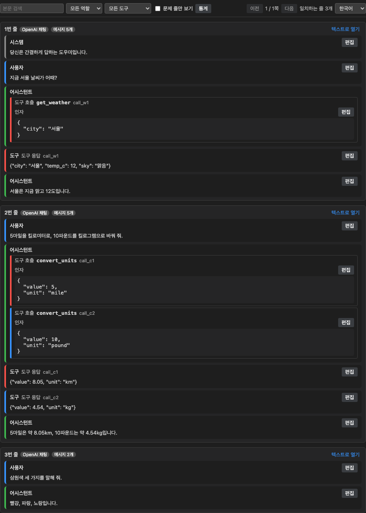
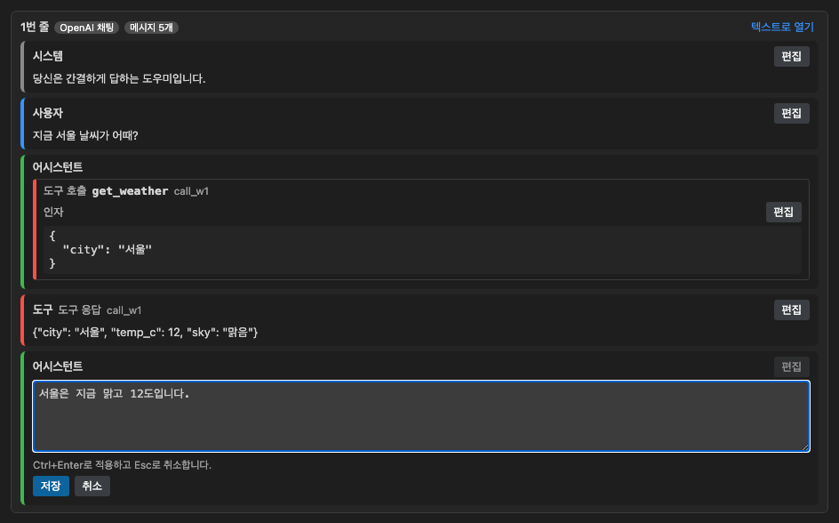
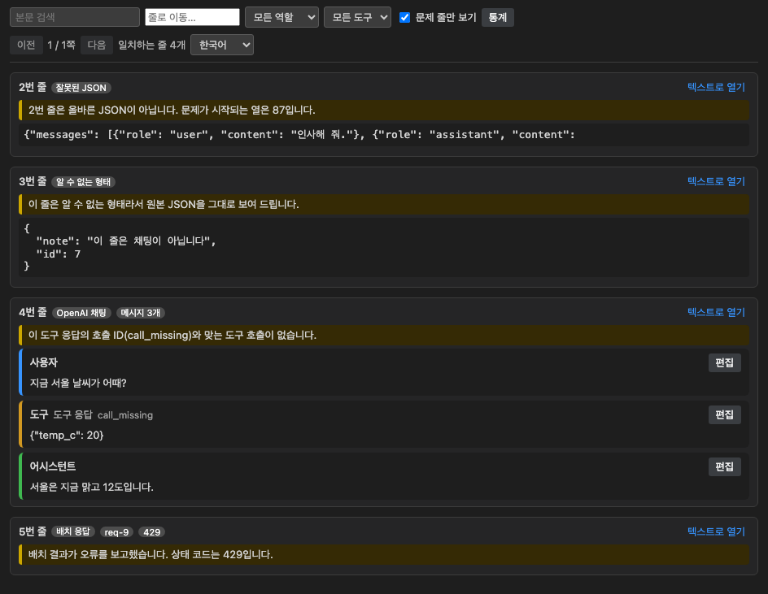
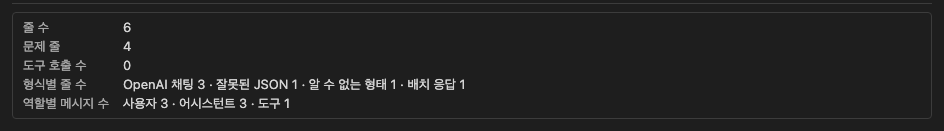
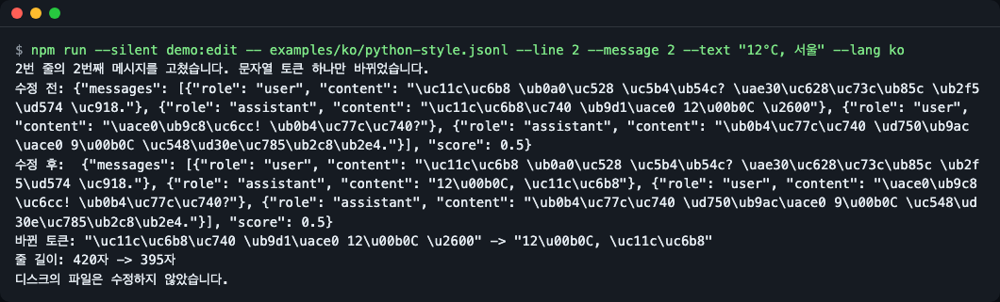

# chatlines

[English](README.md) | **한국어**

채팅 형식 JSONL을 VS Code에서 대화로 읽고, 줄을 통째로 다시 쓰지 않고 메시지 하나만 고칩니다.



*채팅 보기(VS Code 창 장식이 없는 미리보기 하네스 화면): JSONL 한 줄이 역할별 말풍선이 됩니다. 도구 호출과 그 응답은 같은 색 띠로 묶입니다.*

## 왜 필요한가

파인튜닝 파일, 평가 세트, 배치 API 결과는 JSONL입니다. 한 줄에 대화 하나가 들어 있고 따옴표는 전부 이스케이프되어 있습니다. 37번 줄을 읽으려면 3,000자를 옆으로 스크롤해야 하고, 오타 하나를 고치려면 그 긴 줄을 손으로 편집해야 합니다.

chatlines는 같은 파일을 카드 목록으로 엽니다. 카드마다 메시지를 역할별로 보여 주고, 도구 호출을 그 응답과 짝지어 주며, 메시지 하나를 편집할 수 있습니다. 저장하면 그 줄의 그 문자열 하나만 바뀝니다. 줄의 나머지는 바이트 그대로이므로 `git diff`가 작게 유지됩니다.

오프라인으로 동작합니다. 데이터를 어디에도 보내지 않고 API 키도 필요 없습니다.

## 기능

- 줄마다 다섯 가지 채팅 형식을 감지합니다: OpenAI 채팅, ShareGPT, Alpaca, 배치 요청, 배치 응답. 그 밖의 줄은 원본 JSON으로 보여 줍니다.
- `system`, `user`, `assistant`, `tool` 메시지를 색깔 말풍선으로, 도구 호출을 들여쓴 인자가 있는 카드로 보여 줍니다.
- `tool_call_id`로 도구 호출과 응답을 짝지어 양쪽에 같은 색 띠를 붙입니다.
- 메시지 하나(또는 도구 호출 인자 하나)씩 편집합니다. Ctrl+Z(macOS는 Cmd+Z)로 되돌릴 수 있습니다.
- 역할·도구 이름·본문·"문제 줄만 보기"로 거르고, 통계를 보여 주며, 큰 파일은 쪽으로 나눠 보여 줍니다(기본 50줄).
- 데이터 문제(잘못된 JSON, 알 수 없는 형태, 짝 없는 도구 호출 ID, 잘못된 인자, 배치 오류)를 카드에 표시합니다.
- 영어·한국어 화면을 지원합니다.

## 설치

VS Code 1.90 이상이 필요합니다.

아직 Marketplace에는 올라가 있지 않습니다. 소스에서 `.vsix` 패키지를 만듭니다(Node.js 22 이상 필요, `brew install node` 또는 <https://nodejs.org>에서 설치).

```bash
git clone https://github.com/LeeGyeongPil/chatlines.git
cd chatlines
npm ci
npm run package
code --install-extension chatlines-0.1.0.vsix
```

npm 11에서는 `npm ci` 중 `esbuild`, `@vscode/vsce-sign`에 대해 "install-scripts not yet covered by allowScripts" 경고가 나올 수 있습니다. 무시해도 됩니다. 빌드와 패키징에 그 스크립트는 필요하지 않습니다.

`npm run package`의 마지막 줄은 다음과 같습니다.

```
 DONE  Packaged: .../chatlines-0.1.0.vsix
```

`code` 명령이 없으면 VS Code 명령 팔레트의 "Extensions: Install from VSIX..."를 쓰세요.

## 빠르게 시작하기

VS Code에 설치하지 않고도 써 볼 수 있습니다. 미리보기 하네스는 같은 웹뷰와 core 코드를 브라우저 페이지에서 실행합니다.

```bash
npm ci
npm run preview
```

마지막 줄에 페이지 경로가 출력됩니다(예: `.../preview/out/index.html`). 브라우저로 여세요. 주소 끝에 `?fixture=mixed-problems&problems=1`을 붙이면 문제 줄 보기를 볼 수 있습니다.

확장을 설치한 VS Code에서는 다음처럼 합니다.

1. 탐색기에서 `.jsonl` 파일을 우클릭해 **chatlines: 대화로 열기**를 고릅니다. 또는 파일을 열고 **Reopen Editor With... → 대화 보기**를 씁니다.
2. 카드를 읽습니다. 메시지의 **편집**을 눌러 문장을 고치고 Ctrl+Enter(macOS는 Cmd+Enter)로 적용합니다(Esc는 취소).
3. 평소처럼 파일을 저장합니다(Ctrl+S, macOS는 Cmd+S). 편집을 되돌리려면 Ctrl+Z(macOS는 Cmd+Z)를 누릅니다.

`.jsonl` 파일은 기본으로 여전히 일반 텍스트 편집기로 열립니다. 채팅 보기는 직접 고를 때만 쓰입니다.



*메시지 하나 편집: 적용하거나 취소할 때까지 텍스트 상자가 메시지 자리를 대신합니다.*

## 사용법

| 위치 | 하는 일 |
|---|---|
| 역할 / 도구 이름 | 그 역할이나 도구가 들어 있는 줄만 남깁니다 |
| 본문 검색 | 메시지 본문을 대소문자 구분 없이 검색합니다 |
| 문제 줄만 보기 | 데이터 문제가 있는 줄만 남깁니다 |
| 통계 | 줄 수, 형식별 줄 수, 역할별 메시지 수, 도구 호출 수, 문제 줄 |
| 이전 / 다음 | 파일을 쪽 단위로 넘깁니다 |
| 텍스트로 열기 | 그 줄 위치에서 일반 텍스트 편집기로 넘어갑니다 |
| 언어 메뉴 | English 또는 한국어, `chatlines.language` 설정에 저장됩니다 |

필터와 통계는 파일 전체를 조각으로 나눠 훑고, 문서가 바뀌면 다시 시작합니다.



*`examples/ko/mixed-problems.jsonl`의 "문제 줄만 보기".*



*통계 패널.*

## 지원하는 형식

| 형식 | 한 줄의 모양 | 편집 가능 |
|---|---|---|
| OpenAI 채팅 | `{"messages":[{"role","content"}], "tools":[...]}` (content는 문자열·null·파츠 배열, `tool_calls`, `tool_call_id`, `weight`) | 메시지 본문, 텍스트 파츠, 도구 호출 인자 |
| ShareGPT | `{"conversations":[{"from","value"}]}` | `value` |
| Alpaca | `{"instruction","input","output"}` | 세 필드 |
| 배치 요청 | `{"custom_id","method","url","body":{"messages":[...]}}` | 메시지 본문 |
| 배치 응답 | `{"id","custom_id","response":{"status_code","body":{"choices":[{"message"}]}},"error"}` | `choices[].message.content` |

문자열이 아닌 값(예: `content: null`)은 이번 버전에서 편집하지 않습니다. ShareGPT의 `function_call` 값은 도구 호출 카드가 아니라 어시스턴트 본문으로 보입니다.

## 편집이 최소로 유지되는 방법

chatlines는 값마다 시작과 끝 위치를 기억하는 JSON 파서로 줄을 읽습니다. 메시지를 고칠 때는 그 문자열 토큰만 바꾸고, 새 문장은 줄이 이미 쓰는 스타일로 씁니다. 구분자(`", "` 또는 `","`), `\uXXXX` 이스케이프(소문자·대문자) 또는 원문 UTF-8, `\/`가 그 스타일입니다. `1.0`이나 `12345678901234567890` 같은 숫자는 다시 파싱하지 않으므로 그대로 남습니다. BOM, CRLF 줄바꿈, 마지막 줄 개행 없음도 유지됩니다.

`JSON.stringify`는 줄 전체를 다시 쓰게 됩니다. 예제 파일에 편집을 적용해 보는 명령줄 데모로 최소 편집을 볼 수 있습니다. 데모는 파일을 수정하지 않습니다.

```bash
npm run --silent demo:edit -- examples/ko/python-style.jsonl --line 2 --message 2 --text "12°C, 서울" --lang ko
```

```
2번 줄의 2번째 메시지를 고쳤습니다. 문자열 토큰 하나만 바뀌었습니다.
수정 전: {"messages": [{"role": "user", "content": "\uc11c\uc6b8 \ub0a0\uc528 \uc5b4\ub54c? \uae30\uc628\uc73c\ub85c \ub2f5\ud574 \uc918."}, {"role": "assistant", "content": "\uc11c\uc6b8\uc740 \ub9d1\uace0 12\u00b0C \u2600"}, {"role": "user", "content": "\uace0\ub9c8\uc6cc! \ub0b4\uc77c\uc740?"}, {"role": "assistant", "content": "\ub0b4\uc77c\uc740 \ud750\ub9ac\uace0 9\u00b0C \uc548\ud30e\uc785\ub2c8\ub2e4."}], "score": 0.5}
수정 후:  {"messages": [{"role": "user", "content": "\uc11c\uc6b8 \ub0a0\uc528 \uc5b4\ub54c? \uae30\uc628\uc73c\ub85c \ub2f5\ud574 \uc918."}, {"role": "assistant", "content": "12\u00b0C, \uc11c\uc6b8"}, {"role": "user", "content": "\uace0\ub9c8\uc6cc! \ub0b4\uc77c\uc740?"}, {"role": "assistant", "content": "\ub0b4\uc77c\uc740 \ud750\ub9ac\uace0 9\u00b0C \uc548\ud30e\uc785\ub2c8\ub2e4."}], "score": 0.5}
바뀐 토큰: "\uc11c\uc6b8\uc740 \ub9d1\uace0 12\u00b0C \u2600" -> "12\u00b0C, \uc11c\uc6b8"
줄 길이: 420자 -> 395자
디스크의 파일은 수정하지 않았습니다.
```

이 파일은 Python의 `json.dumps`로 쓰였으므로 새 문장도 같은 방식(`\u00b0`, `\uc11c\uc6b8`)으로 이스케이프되고, 구분자·키 순서·`"score": 0.5`는 그대로입니다.



*같은 명령을 스크린샷으로 본 모습.*

## 데이터 문제와 오류의 차이

| 종류 | 예 | 보이는 모습 |
|---|---|---|
| 데이터 문제(파일 쪽) | 잘못된 JSON, 알 수 없는 형태, 짝 없는 도구 응답, 응답 없는 도구 호출, JSON이 아닌 인자, 배치 `error` 또는 400 이상 상태 코드 | 카드에 경고 배지와 문장이 보입니다. 로그에는 아무것도 남지 않습니다. |
| 입력 문제 | 인자 상자에 잘못된 JSON을 입력 | 편집 상자 안에 안내가 뜹니다. 편집은 전송되지 않습니다. |
| 도구 오류 | 편집을 적용하지 못함, 편집하는 동안 줄이 바뀜 | "텍스트로 열기" 버튼이 있는 배너가 뜹니다. 줄이 바뀐 경우는 그 줄을 다시 불러오며, 편집 실패와 내부 오류만 "chatlines" 출력 채널에도 남습니다. 파일은 바뀌지 않습니다. |

편집하는 동안 줄이 바뀌면 그 편집은 거부되고(웹뷰가 문서 버전과 줄 해시를 함께 보냅니다) 최신 내용이 표시됩니다.

## 언어

- 화면: 도구 모음의 언어 메뉴에서 English와 한국어를 바로 바꿀 수 있습니다.
- 설정: `chatlines.language`는 `auto`, `en`, `ko` 중 하나입니다. `auto`는 VS Code 표시 언어를 따릅니다(`ko`로 시작하면 한국어, 아니면 영어).
- 한계: 명령 제목과 설정 설명은 `package.nls*.json`을 통해 VS Code가 번역하므로 `chatlines.language`가 아니라 VS Code 표시 언어를 따릅니다.
- 명령줄 데모: `--lang en|ko`, 그다음 `CHATLINES_LANG`, 그다음 `LANG` 순이며 한국어가 아니면 영어입니다.
- 미리보기 하네스: 주소에 `?lang=ko`를 붙입니다.

## 설정

| 설정 | 기본값 | 뜻 |
|---|---|---|
| `chatlines.language` | `auto` | `auto`, `en`, `ko` |
| `chatlines.pageSize` | `50` | 한 쪽의 줄 수, 10~200 |

## 대안

이런 경우에 잘 맞습니다: VS Code에서 채팅 형식 JSONL을 눈으로 검토하거나 정리할 때, 도구 호출과 응답의 짝이 필요할 때, 손으로 고치고도 diff를 최소로 남기고 싶을 때.

다른 경우에는 다른 도구가 더 맞을 수 있습니다(기능은 바뀌므로 여기서 비교하지 않습니다. 각 프로젝트에서 직접 확인하세요).

- [JSONL Gazelle](https://github.com/gaborcselle/jsonl-gazelle): VS Code용 범용 JSONL 뷰어.
- [Bread Dataset Viewer](https://github.com/Bread-Technologies/Bread-Dataset-Viewer): 데이터셋 뷰어 확장.
- [OpenAI Euphony](https://github.com/openai/euphony): 브라우저 기반 대화 뷰어.
- [jq](https://jqlang.org/): 파일 전체에 대한 스크립트 일괄 변경.

## 한계

- VS Code는 50MB보다 큰 파일을 확장에 공유하지 않습니다. chatlines는 안내 문구를 보여 주며, 파일을 텍스트로 열거나 나눠야 합니다.
- 이번 버전에서는 메시지나 줄을 추가·삭제할 수 없고 기존 문자열만 고칠 수 있습니다.
- 인자가 올바른 JSON이 아닌 도구 호출은 읽기 전용입니다.
- `/v1/responses` 형태의 배치 출력은 아직 지원하지 않습니다.
- VS Code만 대상으로 합니다. Cursor 같은 포크는 확인하지 않았습니다.

## 문제 해결

| 증상 | 원인 | 해결 |
|---|---|---|
| `.jsonl` 파일이 일반 텍스트로 열림 | 채팅 보기는 직접 고를 때만 쓰임 | **chatlines: 대화로 열기** 또는 **Reopen Editor With... → 대화 보기** 사용 |
| `code: command not found` | 셸 명령이 설치되어 있지 않음 | VS Code에서 "Shell Command: Install 'code' command in PATH"를 실행하거나 명령 팔레트로 `.vsix` 설치 |
| 파일이 50MB보다 크다는 오류 알림 | 확장에 대한 VS Code 제한 | 텍스트로 열거나 파일을 나눔 |
| 편집이 거부되고 최신 내용이 나타남 | 편집 상자를 연 사이 줄이 바뀜 | 새로 고쳐진 카드에서 다시 편집 |
| `npm ci`가 `EBADENGINE` 경고를 출력 | 빌드에 Node.js 22 이상이 필요한데 Node가 더 오래됨 | Node.js 업데이트 |

## 개발

```bash
npm ci
npm test              # 빌드 + 테스트 80개 (VS Code API 대역 + jsdom)
npm run bench         # 1만 줄 합성 파일
npm run preview       # 브라우저 하네스
npm run test:integration   # 실제 확장 호스트, 첫 실행 때 VS Code 빌드를 내려받음
```

기본 테스트는 VS Code API 대역을 씁니다. 실제 확장 호스트는 `npm run test:integration`으로 확인하세요(`npm test`에는 포함되지 않습니다). 첫 실행 때 VS Code 빌드를 내려받으므로 네트워크와 데스크톱 세션이 필요합니다.

`npm run bench`를 1만 줄·11.2MB 합성 파일에서 돌린 출력입니다(시간은 머신에 따라 다릅니다).

```
{
  "lines": 10000,
  "megabytes": 11.2,
  "scanMs": 86,
  "pageParseMs": 0.2,
  "toolCalls": 21427,
  "budgetMs": {
    "scan": 3000,
    "page": 100
  },
  "pass": true
}
```

## 라이선스

MIT, [LICENSE](LICENSE) 참고. 보안 신고는 [SECURITY.md](SECURITY.md)를 보세요.
