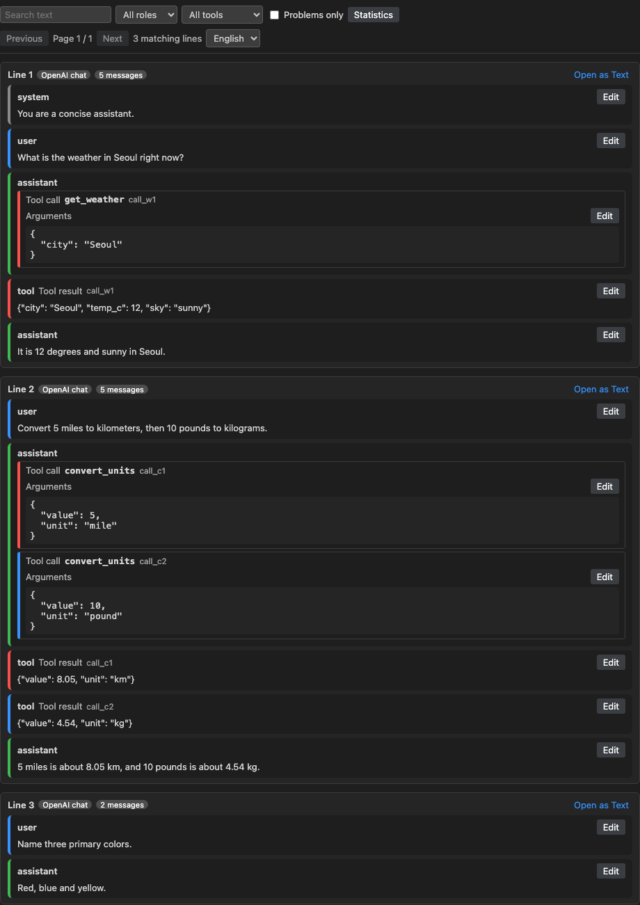
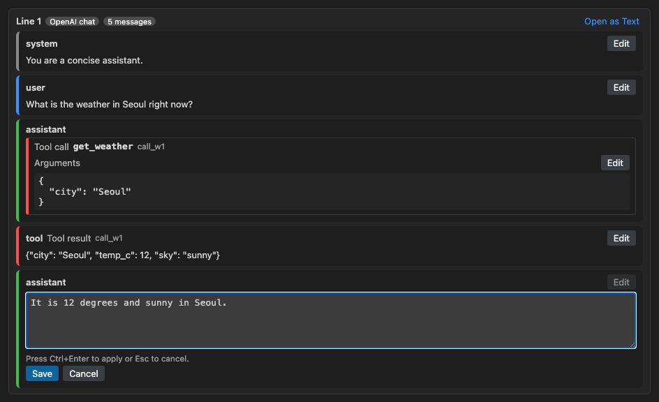
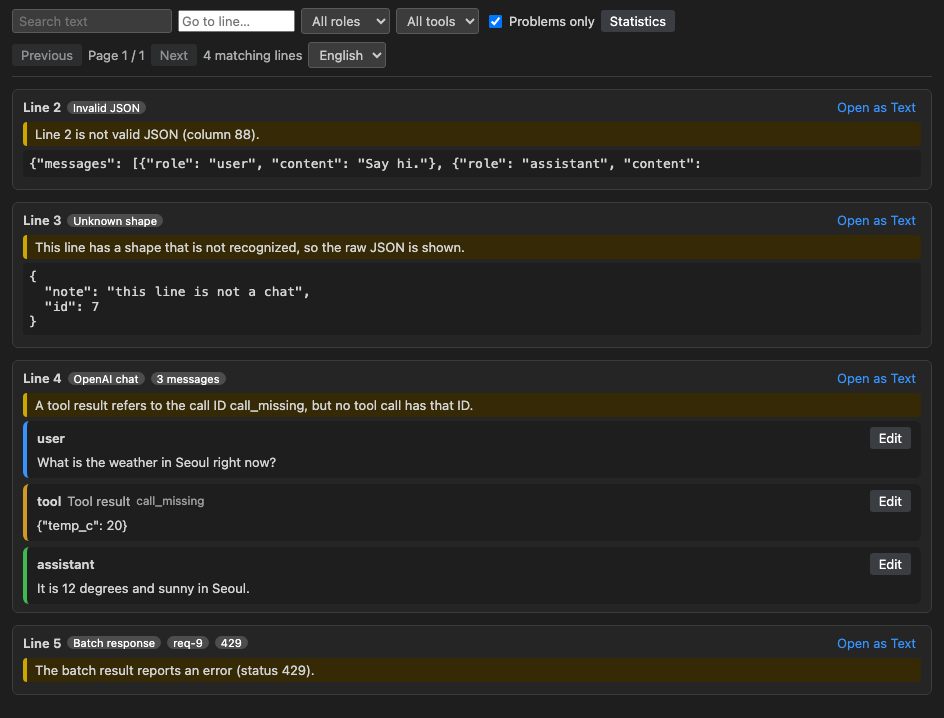
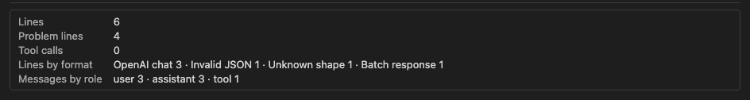
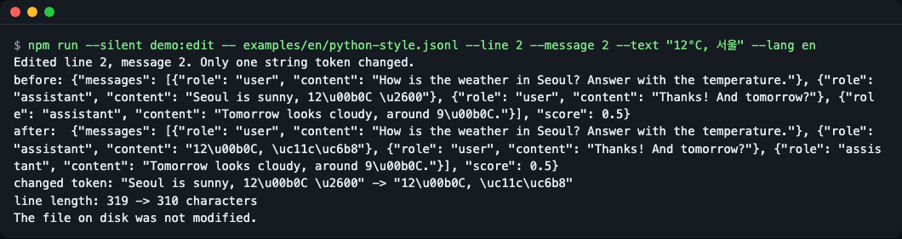

# chatlines

**English** | [한국어](README.ko.md)

Read chat-format JSONL as conversations in VS Code, and fix one message without rewriting the line.



*The chat view (preview harness screen, without the VS Code window frame): one JSONL line becomes role bubbles. The tool call and its result share a color band.*

## Why

Fine-tuning files, evaluation sets and batch API results are JSONL: one conversation per line, with every quote escaped. Reading line 37 means scrolling sideways through 3,000 characters. Fixing a typo means editing that long line by hand.

chatlines opens the same file as a list of cards. Each card shows the messages by role, pairs every tool call with its result, and lets you edit one message. When you save, only that one string inside that one line changes. The rest of the line stays byte for byte as it was, so `git diff` stays small.

It runs offline. It does not send your data anywhere and needs no API key.

## Features

- Detects five chat formats per line: OpenAI chat, ShareGPT, Alpaca, batch requests and batch responses. Anything else is shown as raw JSON.
- Shows `system`, `user`, `assistant` and `tool` messages as colored bubbles, and tool calls as cards with indented arguments.
- Pairs a tool call with its result through `tool_call_id`, with the same color band on both.
- Edits one message (or one tool call's arguments) at a time; undo works with Ctrl+Z (Cmd+Z on macOS).
- Filters by role, tool name, text and "problems only"; shows statistics; pages through large files (50 lines per page by default).
- Reports data problems on the card (invalid JSON, unknown shape, unmatched tool call IDs, bad arguments, batch errors).
- English and Korean screens.

## Install

Requires VS Code 1.90 or newer.

There is no Marketplace listing yet. Build the `.vsix` package from source (Node.js 22 or newer; install it with `brew install node` or from <https://nodejs.org>):

```bash
git clone https://github.com/LeeGyeongPil/chatlines.git
cd chatlines
npm ci
npm run package
code --install-extension chatlines-0.1.1.vsix
```

npm 11 may print "install-scripts not yet covered by allowScripts" warnings for `esbuild` and `@vscode/vsce-sign` during `npm ci`. They can be ignored; the build and packaging do not need those scripts.

`npm run package` ends with:

```
 DONE  Packaged: .../chatlines-0.1.1.vsix
```

If the `code` command is missing, use "Extensions: Install from VSIX..." in the VS Code command palette.

## Quick start

Try it without installing anything into VS Code. The preview harness runs the same webview and core code in a browser page:

```bash
npm ci
npm run preview
```

The last line printed is the path of the page, for example `.../preview/out/index.html`. Open it in a browser. Add `?fixture=mixed-problems&problems=1` to the address to see the problem view.

In VS Code, with the extension installed:

1. Right-click a `.jsonl` file in the Explorer and choose **chatlines: Open as Chat**. Or open the file and use **Reopen Editor With... → Chat view**.
2. Read the cards. Click **Edit** on a message, change the text, then press Ctrl+Enter (Cmd+Enter on macOS; Esc cancels).
3. Save the file as usual (Ctrl+S, Cmd+S on macOS). Press Ctrl+Z (Cmd+Z on macOS) to undo an edit.

`.jsonl` files still open in the normal text editor by default. The chat view is opt-in.



*Editing one message: the text area replaces the message until you apply or cancel.*

## Usage

| Where | What it does |
|---|---|
| Role / Tool name | Keep only lines that contain that role or tool |
| Search text | Case-insensitive text search over messages |
| Problems only | Keep only lines with data problems |
| Statistics | Lines, lines per format, messages per role, tool calls, problem lines |
| Previous / Next | Page through the file |
| Open as Text | Jump to that line in the plain text editor |
| Language menu | English or Korean, saved to the `chatlines.language` setting |

Filters and statistics scan the whole file in chunks and restart if the document changes.



*"Problems only" on `examples/en/mixed-problems.jsonl`.*



*The statistics panel.*

## Supported formats

| Format | Shape of a line | Editable |
|---|---|---|
| OpenAI chat | `{"messages":[{"role","content"}], "tools":[...]}` (content as string, null or parts; `tool_calls`; `tool_call_id`; `weight`) | message text, text parts, tool call arguments |
| ShareGPT | `{"conversations":[{"from","value"}]}` | `value` |
| Alpaca | `{"instruction","input","output"}` | the three fields |
| Batch request | `{"custom_id","method","url","body":{"messages":[...]}}` | message text |
| Batch response | `{"id","custom_id","response":{"status_code","body":{"choices":[{"message"}]}},"error"}` | `choices[].message.content` |

Values that are not strings (for example `content: null`) are not editable in this version. ShareGPT `function_call` values appear as assistant text, not as tool call cards.

## How edits stay minimal

chatlines parses each line with a JSON parser that remembers where every value starts and ends. To edit a message it replaces only that string token and writes the new text in the style the line already uses: separators (`", "` or `","`), `\uXXXX` escapes (lower or upper case) or raw UTF-8, and `\/`. Numbers such as `1.0` or `12345678901234567890` are never re-parsed, so they survive unchanged. A BOM, CRLF line endings and a missing final newline are kept too.

Compare that with `JSON.stringify`, which would rewrite the whole line. You can see the minimal edit with the command line demo, which works on the example files and does not modify them:

```bash
npm run --silent demo:edit -- examples/en/python-style.jsonl --line 2 --message 2 --text "12°C, 서울" --lang en
```

```
Edited line 2, message 2. Only one string token changed.
before: {"messages": [{"role": "user", "content": "How is the weather in Seoul? Answer with the temperature."}, {"role": "assistant", "content": "Seoul is sunny, 12\u00b0C \u2600"}, {"role": "user", "content": "Thanks! And tomorrow?"}, {"role": "assistant", "content": "Tomorrow looks cloudy, around 9\u00b0C."}], "score": 0.5}
after:  {"messages": [{"role": "user", "content": "How is the weather in Seoul? Answer with the temperature."}, {"role": "assistant", "content": "12\u00b0C, \uc11c\uc6b8"}, {"role": "user", "content": "Thanks! And tomorrow?"}, {"role": "assistant", "content": "Tomorrow looks cloudy, around 9\u00b0C."}], "score": 0.5}
changed token: "Seoul is sunny, 12\u00b0C \u2600" -> "12\u00b0C, \uc11c\uc6b8"
line length: 319 -> 310 characters
The file on disk was not modified.
```

The file was written by Python's `json.dumps`, so the new text is escaped the same way (`\u00b0`, `\uc11c\uc6b8`), and the separators, the key order and `"score": 0.5` are untouched.



*The same command as a screenshot.*

## Data problems vs. errors

| Kind | Example | How it looks |
|---|---|---|
| Data problem (your file) | invalid JSON, unknown shape, tool result without a matching call, tool call without a result, arguments that are not JSON, batch `error` or status code 400 or higher | A warning badge and a sentence on the card. Nothing is written to the log. |
| Input problem | invalid JSON typed into the arguments box | A hint in the edit box. No edit is sent. |
| Tool error | the edit could not be applied, the line changed while you edited | A banner with "Open as Text". A stale edit reloads the line; only failed edits and internal errors are also written to the "chatlines" output channel. The file is not changed. |

A line that changed while you were editing is rejected (the webview sends the document version and a hash of the line), and the latest content is shown.

## Language

- In the view: the language menu in the toolbar switches between English and Korean at once.
- Setting: `chatlines.language` is `auto`, `en` or `ko`. `auto` follows the VS Code display language (Korean if it starts with `ko`, otherwise English).
- Limit: command titles and setting descriptions are translated by VS Code from `package.nls*.json`, so they follow the VS Code display language, not `chatlines.language`.
- Command line demo: `--lang en|ko`, then `CHATLINES_LANG`, then `LANG`; anything that is not Korean gives English.
- Preview harness: `?lang=ko` in the address.

## Settings

| Setting | Default | Meaning |
|---|---|---|
| `chatlines.language` | `auto` | `auto`, `en` or `ko` |
| `chatlines.pageSize` | `50` | Lines per page, 10 to 200 |

## Alternatives

Good fit: you review or clean chat-format JSONL by eye in VS Code, you need tool call and result pairs, or you want hand fixes that leave a minimal diff.

Other tools may fit better in other cases (we do not compare features here, since they change; check each project):

- [JSONL Gazelle](https://github.com/gaborcselle/jsonl-gazelle): a general JSONL viewer for VS Code.
- [Bread Dataset Viewer](https://github.com/Bread-Technologies/Bread-Dataset-Viewer): a dataset viewer extension.
- [OpenAI Euphony](https://github.com/openai/euphony): a browser-based conversation viewer.
- [jq](https://jqlang.org/): for scripted, bulk changes across a whole file.

## Limits

- VS Code does not share files larger than 50 MB with extensions; chatlines shows a message and you can open the file as text or split it.
- You cannot add or delete messages or lines in this version, only edit existing strings.
- Tool calls whose arguments are not valid JSON are read-only.
- `/v1/responses` style batch output is not supported yet.
- Only VS Code is targeted; forks such as Cursor are untested.

## Troubleshooting

| Symptom | Cause | Fix |
|---|---|---|
| The `.jsonl` file opens as plain text | The chat view is opt-in | Use **chatlines: Open as Chat** or **Reopen Editor With... → Chat view** |
| `code: command not found` | The shell command is not installed | In VS Code run "Shell Command: Install 'code' command in PATH", or install the `.vsix` from the command palette |
| An error notification says the file is larger than 50 MB | VS Code limit for extensions | Open as text or split the file |
| An edit is rejected and the latest content appears | The line changed while the edit box was open | Edit again on the refreshed card |
| `npm ci` prints `EBADENGINE` warnings | The build needs Node.js 22 or newer and your Node is older | Update Node.js |

## Development

```bash
npm ci
npm test              # build + 80 tests (VS Code API stand-in + jsdom)
npm run bench         # 10,000-line synthetic file
npm run preview       # browser harness
npm run test:integration   # real extension host; downloads a VS Code build on first run
```

The default test suite uses a stand-in for the VS Code API; run `npm run test:integration` to check the real extension host (not part of `npm test`). It downloads a VS Code build on first run, so it needs network access and a desktop session.

`npm run bench` on a synthetic 10,000-line, 11.2 MB file prints (timings vary by machine):

```
{
  "lines": 10000,
  "megabytes": 11.2,
  "scanMs": 86,
  "pageParseMs": 0.2,
  "toolCalls": 21427,
  "budgetMs": {
    "scan": 3000,
    "page": 100
  },
  "pass": true
}
```

## License

MIT, see [LICENSE](LICENSE). Security reports: [SECURITY.md](SECURITY.md).
